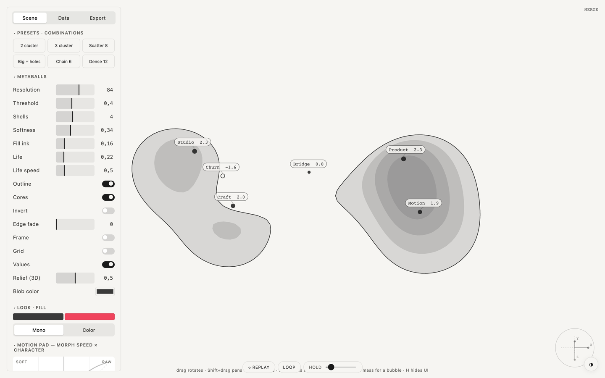

  

<h1 align="center">Metaballs</h1>

  Soft masses that merge, split and leave holes 
  one HTML file · runs in the browser · no install · free and open source

  <a href="https://robvagin.github.io/metaballs/"><b>Open Metaballs</b></a> ·
  <a href="#run-it">Run it</a> ·
  <a href="#more-tools">More tools</a>

---

Drops of a field: close masses melt into one shape, negative ones eat holes into it, and with Life switched on the whole thing breathes.

## Use it for

- organic shapes for a brand system
- clusters of data drawn as soft masses

## What it does

- **Masses** with a weight (plus is a drop, minus is a hole) and a radius of influence
- **Presets:** 2 cluster, 3 cluster, big with holes, chain of 6, dense 12, scatter 8
- **Life** keeps joining and splitting the clusters; a click on a mass opens its note
- **Look:** mono or color fill, outline, cores, relief, grid and values
- **Export:** PNG, SVG and a JSON config

## Run it

Open [robvagin.github.io/metaballs](https://robvagin.github.io/metaballs/), or download `index.html` and open it from your disk. It is the whole tool: no build step, no dependencies, no network. Press **H** to hide the panel.

## Made by a designer

I'm a designer. I build small tools like this for my own work, with AI agents: I make the decisions, Claude Code writes the code. The panels follow one grammar across the whole set.

Take it if you want it.

## More tools

- [GONE](https://github.com/robvagin/gone-player) · a macOS player for the thirty minutes before a DJ set
- [PSP Engine](https://github.com/robvagin/shar-psp-engine) · a native engine that runs a PS2 game on the PSP. Not an emulator
- [Particle Dance](https://github.com/robvagin/particle-dance) · particles that dance along patterns and 3D forms
- [XYZ Cube](https://github.com/robvagin/xyz-cube) · your data as points in a 3D cube on axes you name
- [Pack Label](https://github.com/robvagin/pack-label) · coffee bag labels, checked and ready for print
- [Image Shuffler](https://github.com/robvagin/image-shuffler) · your screenshots flying in 3D, recorded as a video
- [Sunburst](https://github.com/robvagin/sunburst) · a hierarchy as a 3D sunburst chart with height
- [Halftone Cloud](https://github.com/robvagin/halftone-cloud) · images rebuilt as a halftone of flying shapes
- [Motion Primer](https://github.com/robvagin/motion-primer) · bodies that swarm, orbit, fall and gather into a word
- [Murmur](https://github.com/robvagin/murmur-vj) · a VJ visualizer: circles, triangles and squares that move to your music
- [Particles 3D](https://github.com/robvagin/particles-3d) · a WebGL2 cloud of up to 300,000 particles
- [Thinking Sphere](https://github.com/robvagin/thinking-sphere) · a glass sphere with soft shapes drifting inside
- [Line Engine](https://github.com/robvagin/line-engine) · engraved line patterns in motion: Lissajous, rosettes, waves
- [Orbital](https://github.com/robvagin/orbital) · data as orbits, axes or a bending mesh
- [Logomachine](https://github.com/robvagin/logomachine) · seeded generative marks: one seed, one pattern, always
- [Ellipse Sphere](https://github.com/robvagin/ellipse-sphere) · a sphere built from stacked discs that fan open and assemble
- [Hexbin](https://github.com/robvagin/hexbin) · a point cloud counted into 3D hexagon towers
- [Chart 3D](https://github.com/robvagin/chart-3d) · pie, bars, polar and area charts in 3D, with an entrance
- [Voronoi](https://github.com/robvagin/voronoi) · points that share space as cells, inside any shape
- [Motion Pad](https://github.com/robvagin/motion-pad) · one pad for the character of motion

## License

[MIT](LICENSE) © 2026 Robert Vagin
